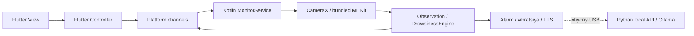

# Arxitektura va qarorlar

## MVC chegaralari

Flutter View faqat ekran chizadi va controller amallarini chaqiradi. Controller
MethodChannel orqali Android adapteriga so‘rov yuboradi, EventChannel orqali holatni
oladi. Kotlin Model ichidagi DrowsinessEngine Android API’lariga bog‘liq emas.
CameraSession model uchun Observation yaratadi. MonitorService resurslar va fon
hayot siklini boshqaradi. AlarmController faqat model qaroriga javob beradi.

Kadrlar Kotlin ichida qoladi; Flutter stream faqat raqamlar va holat matnini oladi.
Inference backpressure eng oxirgi kadrni saqlaydi, tahlil taxminan 8 FPS bilan
chegaralanadi. Bu Galaxy A51’da o‘lchangan FPS emas; qurilmada profil qilish kerak.

## Aniqlash

- Bitta yuz va ishonchli ikkala ko‘z klassifikatsiyasi kerak.
- Yaw ±18°, pitch ±30°, roll ±25° ichida bo‘lgandagina ko‘z dalili qabul qilinadi.
- Ikkala ko‘z ochiqligi <0.35 bo‘lsa yopiq deb olinadi.
- 700 ms da UI ogohlantiradi, 1500 ms da signal beradi.
- PERCLOSga o‘xshash yopiq ko‘z ulushi 30 s oynada, kuzatilgan vaqt bilan hisoblanadi.
  Bu klinik PERCLOS validatsiyasi emas; past ko‘z ochiqligi ehtimollari ishlatiladi.
- 700 ms dan katta kadr uzilishlari tarixni tozalaydi; kuzatilmagan vaqt ko‘z yumilishi
  sifatida sanalmaydi. Alohida watchdog 3 s kadr kelmasa cheklov signalini beradi.
- Yuz identity’si o‘zgarsa vaqt tarixi yangilanadi. Bir nechta yuz ko‘rinsa haydovchi
  taxminan tanlanmaydi; kamerani faqat haydovchiga qaratish talab qilinadi.
- Boshlang‘ich chegaralar tadqiqot taxminlari; haqiqiy dataset va telefonda sozlanishi kerak.

## Fon rejimi

Camera foreground service foydalanuvchi ilova ichida Start bosganda kamera ruxsatidan
keyin boshlanadi. Bildirishnomada Stop bor. Activity backgroundga o‘tganda preview
ajratiladi, ImageAnalysis service LifecycleOwner’da qoladi. START_NOT_STICKY ishlatiladi:
process o‘lgandan keyin kamera foydalanuvchisiz qayta ochilmaydi. Boot receiver yo‘q.

Android yoki Samsung processni o‘ldirsa, telefon qizib ketsa, kamera boshqa ilovaga
o‘tsa yoki ruxsat bekor qilinsa, davomiylik kafolatlanmaydi. Ekran o‘chgan holat,
batareya optimizatsiyasi, signal/DND va telefon qo‘ng‘irog‘i jismoniy sinov talab qiladi.

## Ma’lumot va LLM

Tasvir/video saqlash, kamera upload endpoint’i va mikrofon ruxsati yo‘q.
SharedPreferences’da faqat voice/llm sozlamalari turadi. LLM API loopback’da ishlaydi;
Android cleartext faqat 127.0.0.1 uchun ruxsat etilgan. `adb reverse` USB tunnel beradi.
Ollama so‘roviga faqat oldindan belgilangan matn yuboriladi. LLM natijasi kafolatlangan
xavfsiz matn emas; uning oldidan qat’iy "to‘xtab dam oling" ogohlantirishi aytiladi.
Serverni LAN/internetga ochish bu versiya doirasiga kirmaydi.

## Rasmiy manbalar

- [Flutter platform channels](https://docs.flutter.dev/platform-integration/platform-channels)
- [Flutter SDK archive](https://docs.flutter.dev/install/archive)
- [Android camera foreground service](https://developer.android.com/develop/background-work/services/fgs/service-types#camera)
- [Foreground service background restrictions](https://developer.android.com/develop/background-work/services/fgs/restrictions-bg-start)
- [ML Kit Android face detection](https://developers.google.com/ml-kit/vision/face-detection/android)
- [ML Kit face angles and frontal eye classification](https://developers.google.com/ml-kit/vision/face-detection/face-detection-concepts)
- [Ultralytics pose keypoints](https://docs.ultralytics.com/tasks/pose/)
- [Ollama chat API](https://docs.ollama.com/api/chat)

## Release optimizatsiyasi

`app/proguard-rules.pro` ML Kit reflection orqali yaratadigan Firebase
ComponentRegistrar implementatsiyalarining public no-arg konstruktorlarini saqlaydi.
Emulyatordagi release sinovida bu qoidasiz FaceDetection.getClient ishlamasligi
aniqlandi. [R8 / ML Kit issue](https://issuetracker.google.com/issues/574078150).
