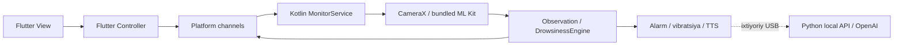

# Arxitektura va qarorlar

## MVC chegaralari

Flutter View faqat ekran chizadi va controller amallarini chaqiradi. Controller
MethodChannel orqali Android adapteriga so‘rov yuboradi, EventChannel orqali holatni
oladi. Kotlin Model ichidagi DrowsinessEngine Android API’lariga bog‘liq emas.
CameraSession model uchun Observation yaratadi. MonitorService resurslar va fon
hayot siklini boshqaradi. AlarmController faqat model qaroriga javob beradi.

Kadrlar Kotlin ichida qoladi; Flutter stream faqat raqamlar va holat matnini oladi.
Inference backpressure eng oxirgi kadrni saqlaydi, tahlil taxminan 8 FPS bilan
chegaralanadi. Bu Galaxy A51’da o‘lchangan FPS emas; qurilmada profil qilish kerak.

## Aniqlash

- Bitta kuzatilayotgan yuz kerak. Frontal rejimda yaw ±18°, pitch ±30° va
  roll ±25° ichida ML Kit’ning ikkala ko‘z klassifikatsiyasi ishlatiladi.
  Ikkala qiymat <0.35 bo‘lsa yopiq deb olinadi.
- |Yaw| 18° dan katta va 60° gacha, pitch va roll ±25° ichida bo‘lsa,
  MediaPipe Face Landmarker CPU modeli ko‘rinadigan ko‘zni tekshiradi.
  Bitta kuzatilayotgan yuz, yuz ichidagi burun va ko‘z nuqtalari talab qilinadi.
- Yaqin ko‘z qovog‘i geometriyasi va eyeBlink klassifikatori kelishganda
  ochiq/yopiq holati beriladi. Ko‘z kamida 10 piksel kenglikda bo‘lishi kerak.
  Blink ≥0.45 va qovoq nisbati ≤0.11 bo‘lsa kuchli yopilish dalili olinadi.
  Blink ≥0.65 va nisbat ≤0.16 ham yopiq hisoblanadi. Blink ≤0.25 va
  nisbat 0.12–0.65 ochiq hisoblanadi. Bu chegaralar tajriba uchun, kamera validatsiyasi zarur.
- 700 ms da UI ogohlantiradi, 1500 ms da signal beradi.
- PERCLOSga o‘xshash yopiq ko‘z ulushi 30 s oynada, kuzatilgan vaqt bilan hisoblanadi.
  Ko‘zlar 3 s davomida baholanmasa, oldingi ulush tarixi tozalanadi.
  Bu klinik PERCLOS validatsiyasi emas. Frontal klassifikatsiya va yon kontur holati ishlatiladi.
- 700 ms dan katta kadr uzilishlari tarixni tozalaydi; kuzatilmagan vaqt ko‘z yumilishi
  sifatida sanalmaydi. Alohida watchdog 3 s kadr kelmasa cheklov signalini beradi.
- Yuz identity’si o‘zgarsa vaqt tarixi yangilanadi. Bir nechta yuz ko‘rinsa haydovchi
  taxminan tanlanmaydi; kamerani faqat haydovchiga qaratish talab qilinadi.
- Boshlang‘ich chegaralar tadqiqot taxminlari; haqiqiy dataset va telefonda sozlanishi kerak.

## Fon rejimi

Camera foreground service foydalanuvchi ilova ichida Start bosganda kamera ruxsatidan
keyin boshlanadi. Bildirishnomada Stop bor. Activity backgroundga o‘tganda preview
ajratiladi, ImageAnalysis service LifecycleOwner’da qoladi. START_NOT_STICKY ishlatiladi:
process o‘lgandan keyin kamera foydalanuvchisiz qayta ochilmaydi. Boot receiver yo‘q.

Android yoki Samsung processni o‘ldirsa, telefon qizib ketsa, kamera boshqa ilovaga
o‘tsa yoki ruxsat bekor qilinsa, davomiylik kafolatlanmaydi. Ekran o‘chgan holat,
batareya optimizatsiyasi, signal/DND va telefon qo‘ng‘irog‘i jismoniy sinov talab qiladi.

## Ma’lumot va LLM

Flutter View sozlamalar va ulanish holatini ko‘rsatadi. Controller ulanishni
tekshiradi va sozlamani saqlaydi. Model qatlamida Kotlin RecoveryTrigger
uyquchanlikdan keyin bir soniyalik ochiq ko‘z dalilini kutadi, Python
DriverConversation esa OpenAI suhbat ID’si va ovozga ruxsat etilgan javoblarni boshqaradi.
Android alarm, TTS va nutqni tanish, HTTP va Flutter platform channel tashqi
xizmatlarga adapter sifatida ishlaydi.

Android mikrofonni faqat yordamchi yoqilgan va ruxsat berilgan kuzatuv sessiyasida,
savol tugaganidan keyin qisqa muddat ochadi. Alarm qaytsa yoki kuzatuv to‘xtasa,
ovozli almashinuv bekor qilinadi. Android nutqni tanish xizmati ishlatiladi va
offline tanish so‘raladi. Xizmatning o‘zi ishlash usulini tanlaydi.

Python server MacBook loopback manzilida ishlaydi. ADB reverse orqali telefon
USB yoki Wi-Fi’dan ulanadi. API kaliti MacBook muhitida qoladi.
OpenAI suhbatiga faqat trigger matni va tanilgan javob matni yuboriladi.
Qayta ulanish, keyingi triggerlar va server qayta ishga tushganda saqlangan
suhbat ID’si ishlatiladi.

## Rasmiy manbalar

- [Flutter platform channels](https://docs.flutter.dev/platform-integration/platform-channels)
- [Flutter SDK archive](https://docs.flutter.dev/install/archive)
- [Android camera foreground service](https://developer.android.com/develop/background-work/services/fgs/service-types#camera)
- [Foreground service background restrictions](https://developer.android.com/develop/background-work/services/fgs/restrictions-bg-start)
- [ML Kit Android face detection](https://developers.google.com/ml-kit/vision/face-detection/android)
- [ML Kit face angles and frontal eye classification](https://developers.google.com/ml-kit/vision/face-detection/face-detection-concepts)
- [Ultralytics pose keypoints](https://docs.ultralytics.com/tasks/pose/)
- [OpenAI Responses API](https://developers.openai.com/api/docs/guides/text)

## Release optimizatsiyasi

`app/proguard-rules.pro` ML Kit reflection orqali yaratadigan Firebase
ComponentRegistrar implementatsiyalarining public no-arg konstruktorlarini saqlaydi.
Emulyatordagi release sinovida bu qoidasiz FaceDetection.getClient ishlamasligi
aniqlandi. [R8 / ML Kit issue](https://issuetracker.google.com/issues/574078150).

## Kompakt dashboard va ko‘z score’i — 2026-11-11

DriveScreen bounded LayoutBuilder/Column orqali portrait va landscape’da
joylashadi. Gemini strip header ostida, camera ustida; Start/Stop pastda doim
ko‘rinadi. Yon ko‘z uzluksiz display score’i Observation orqali keladi, View uni
faqat formatlaydi. DrowsinessEngine display score’idan yon closed qarorini
hisoblamaydi; SideEye blink/gap dalili qarorni beradi. DenseEyeDetector yuz ROI
koordinatalarini original kadrga qaytaradi va bitmap egaligini boshqaradi.

## Unified side-eye score — 2026-11-11, user-requested correction

This supersedes the independent side display score above. SideEye normalizes
its existing blink/gap evidence so the closed boundary is score <=0.50.
DenseEyeDetector publishes that score and derives its legacy Boolean from the
same boundary. DrowsinessEngine uses the score directly, including the 1 500 ms
closure timer and PERCLOS. Recovery requires score >0.50. Unknown quality is
still null. The fallback score is normalized evidence, not a calibrated
probability or an anatomical percentage. A separately trained calibration may
replace it only after the frozen bilateral acceptance protocol passes.

## Repeated closure alarm policy — 2026-11-11

RepeatedClosureAlarm is a pure domain policy: two >=3 000 ms episodes in
60 000 ms arm a 15 000 ms minimum alarm. At least 300 ms of observed opening
separates episodes; unknown frames cannot count one closure twice. New
closures during the held alarm do not continually extend its countdown.
After the deadline, 1 000 ms of known opening allows recovery. The service
renders the countdown through the state message; AlarmController continues
the alarm while state.alarm is true. RecoveryTrigger starts the assistant only
after a further second of fresh, alarm-free open-eye evidence. Stop clears
all state. The previous 30-second PERCLOS remains a risk statistic, but one
second of confirmed opening acknowledges that rolling-risk alarm so it cannot
keep ringing indefinitely after the explicit held alarm finishes. Fresh
sustained closure and visibility-loss alerts remain active.

## Low-light frame preparation — 2026-11-12

FrameLighting is a pure domain policy for original luminance quality, hysteresis
and a bounded tone curve. PreparedCameraFrame is the Android bitmap adapter;
CameraSession owns its lifetime through both asynchronous detectors. Recent
face-region luminance helps a bright background avoid hiding a dark driver.
Raw pixels determine usability; corrected pixels are shared by ML Kit and
Face Landmarker. New lighting state flows through Observation/MonitorState to
Flutter without image transfer. References reset on enhancement transitions or
unusable evidence. No new camera/library dependencies or light overrides.
See LOW_LIGHT.md for thresholds, synthetic evidence and real-night limitations.
